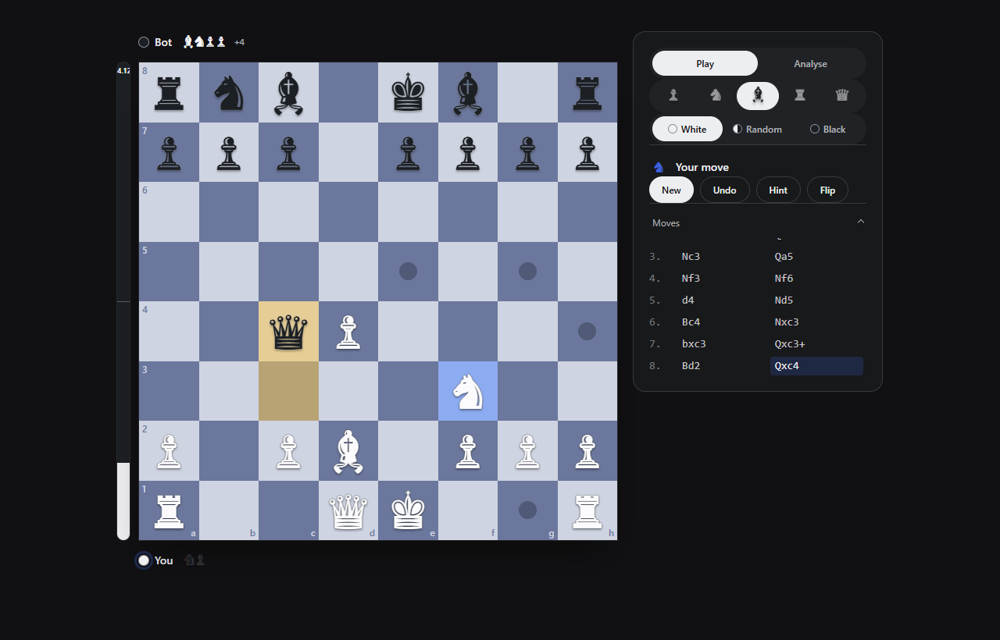
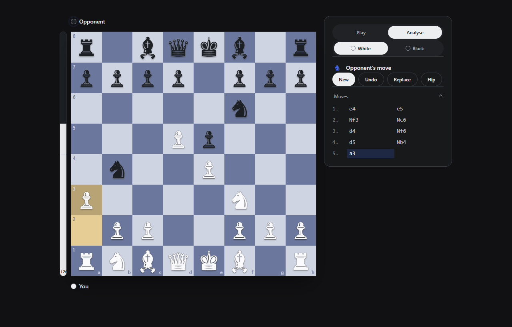
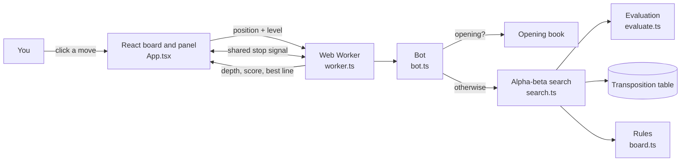

<p align="center">
  
</p>

<h1 align="center">Chess Bot</h1>

<p align="center"><b>A chess engine written from scratch, running entirely in your browser.</b><br/>
Play it at five strengths, or let it play your side of a real game while you enter your opponent's moves.</p>

<p align="center">
  <a href="https://chess-bot-three.vercel.app"><b>Play it live</b></a> ·
  <a href="#how-the-bot-thinks"><b>How the bot thinks</b></a> ·
  <a href="#why-it-is-fast"><b>Why it is fast</b></a> ·
  <a href="#run-it-yourself"><b>Run it yourself</b></a>
</p>

| Play the bot | Analyse a real game |
|---|---|
|  |  |

## What it does

- **Play:** pick a level and a colour, then play against the bot. Hint, Undo and Flip are one click away.
- **Analyse:** the bot plays your side of a game happening somewhere else (over the board, on another site). You
  enter your opponent's moves, and it answers with the best move it can find. If you played something else, enter
  your own move instead, or press **Replace** to swap the bot's move for yours.
- **Eval bar** beside the board shows who is winning, in pawns (or mate in N).
- **Moves** fold away under the panel until you want them.

No server does the thinking. The engine runs in your browser, so it plays just as fast online as it does locally.

## Levels

| Level | How it plays | Rough strength (guess, not measured) |
|---|---|---|
| ♟ Pawn | Looks one move ahead, with lots of random error | ~400 |
| ♞ Knight | Two moves ahead, some random error | ~900 |
| ♝ Bishop | Four moves deep, up to 1.5 s, small error | ~1300 |
| ♜ Rook | Full search for about 1.2 s | ~1700 |
| ♛ Queen | Full search for up to 4 s | ~2000 |

Analyse mode uses the full engine for 2.5 s a move. The strengths are estimates; `npm run elo` can measure them
against Stockfish (see [Run it yourself](#run-it-yourself)).

## How the bot thinks

The engine is a classic one, built from the ground up in TypeScript:

1. **Board and rules** (`board.ts`): a 0x88 board (a 128-square trick that makes off-board checks one operation),
   legal move generation, castling, en passant, promotion, and repetition and 50-move draws. Checked against known
   move counts with `npm run perft`.
2. **Search** (`search.ts`): negamax with **alpha-beta pruning**, which skips lines that can't change the answer.
   On top of that:
   - **Iterative deepening:** search 1 move deep, then 2, then 3, until time runs out, so there is always an answer.
   - **Transposition table:** remembers about a million positions it has already scored.
   - **Principal variation search, null-move pruning and late-move reductions:** spend less time on moves that are
     probably bad.
   - **Quiescence search:** keeps looking at captures past the depth limit, so it doesn't stop mid-trade.
   - **Killer and history moves:** tries the moves that worked before first, so pruning cuts more.
3. **Evaluation** (`evaluate.ts`): material, piece-square tables (where each piece likes to stand), pawn structure
   (doubled, isolated, passed pawns), bishop pair, rooks on open files, and a king that hides early and comes out in
   the endgame. A "mop-up" term pushes a lone enemy king to the edge so won endgames actually get won.
4. **Opening book** (`bot.ts`): common openings are played straight from a list, with no search at all.

## Why it is fast

- **Runs in a Web Worker,** a background thread, so the board never freezes while it thinks.
- **Thinks on your opponent's time.** In Analyse mode, after playing your move the bot guesses the reply and starts
  working on its answer before your opponent has moved. Guess right and the answer is ready almost instantly
  (about 50 ms instead of 2.5 s). Guess wrong and it starts again, keeping everything it learnt.
- **Stops without restarting.** The page and the worker share a tiny piece of memory (a `SharedArrayBuffer`), so a
  search can be told to stop at once and the worker keeps its memory. This needs two security headers, set in
  `vite.config.ts` for local use and `vercel.json` online.
- **Openings cost nothing:** book moves skip the search entirely.

## Architecture



- **Stack:** React 19, TypeScript, Tailwind CSS 4, motion, Vite 7. No chess libraries.
- **Hosting:** static files on Vercel. There is no backend.
- **UI pieces** from my own component library: Magnetic Button, Spotlight Card and Math Curve Loader.

## Run it yourself

```bash
npm install
npm run dev      # open the printed localhost link
```

```bash
npm run perft    # checks the move generator against known move counts
npm run bench    # checks the bot finds mates and free pieces
npm run build    # type-check and build to dist/
```

**Measure the Elo** (needs Stockfish: `npm install stockfish` first):

```bash
npm run elo -- 1000 6 1400,1700,2000   # ms per move, games per level, Stockfish strengths
```

**Deploy:** `vercel deploy --prod`. `vercel.json` already sets the headers the fast stop signal needs.

## Where things are

| Path | What |
|---|---|
| `src/engine/board.ts` | Rules: 0x88 board, legal moves, make/unmake, FEN, move notation |
| `src/engine/search.ts` | Alpha-beta search and everything that makes it faster |
| `src/engine/evaluate.ts` | Scores a position |
| `src/engine/bot.ts` | Levels and the opening book |
| `src/engine/worker.ts` | Runs the bot off the main thread, with the shared stop signal |
| `src/engine/perft.ts`, `bench.ts`, `elo.ts` | Move-count tests, tactics checks, Elo test against Stockfish |
| `src/App.tsx` | Game state, Play and Analyse modes, thinking on the opponent's time |
| `src/components/chess/` | Board, eval bar, level picker, move list |
